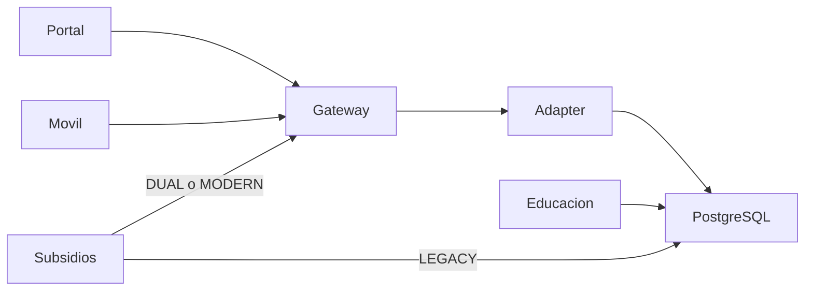

# Arquitectura de la transición

## Contexto

La caja de compensación utiliza una base compartida por aplicaciones antiguas. La transición introduce una frontera HTTP para Afiliaciones y Retiros, manteniendo el código de Educación y Portal. Los consumidores nuevos no conocen el esquema físico; Subsidios conserva un recorrido original seleccionable para revertir el dominio sin eliminar solicitudes ni datos.

## Componentes

| Componente | Función y comunicación |
|---|---|
| legacy-db | Fuente PostgreSQL con tablas y procedimiento original; conserva también comprobantes transaccionales |
| educacion-app | Consumidor antiguo que consulta directamente PostgreSQL; código y Dockerfile conservados |
| portal-client | Consumidor del kit que consulta al gateway mediante GATEWAY_URL y PORTAL_TOKEN |
| subsidios-app | Envía retiros por HTTP con SUBSIDIOS_TOKEN en DUAL/MODERN; en LEGACY usa el procedimiento original |
| gateway | API FastAPI, modelos canónicos, autenticación, auditoría, adapter, inbox y worker |
| mobile-client | Interfaz web adaptable y proxy HTTP de solo lectura; solo recibe MOBILE_TOKEN y GATEWAY_URL |
| tests | Verificaciones de integración; su conexión directa de comprobación a PostgreSQL es la excepción permitida para pruebas |

src/server.py define las rutas; src/access.py identifica consumidores; src/observability.py maneja auditoría y errores de aplicación; src/db_adapter.py encapsula el esquema. src/inbox.py persiste solicitudes, src/dispatcher.py las recupera y src/migration.py administra estados. Entre los servicios nuevos de negocio solo gateway se conecta a PostgreSQL.

## Modelo canónico

Los modelos de src/schemas.py describen el contrato público. Afiliado contiene document, fullName, status y company; los estados son ACTIVE, RETIRED y SUSPENDED. Beneficiario contiene document, fullName y relationship, con SPOUSE, CHILD, FATHER o MOTHER. Empresa contiene id, name y activeMembers, calculado sobre afiliados activos.

El retiro recibe requestId, date y reason; la respuesta incluye requestId, movement y status. movement es null mientras no haya confirmación. Los nombres físicos y la traducción de códigos del sistema antiguo permanecen dentro del adapter; el contrato no expone esas columnas.

## Cambio de esquema

En cada operación, el adapter comprueba cuál de los dos esquemas existe y selecciona identificadores de una lista interna permitida. Los valores del cliente se pasan como parámetros SQL. No se mantiene una detección global que quede obsoleta después del cambio.

El evento suministrado renombra la tabla y dos columnas y actualiza el procedimiento. En la prueba registrada, las consultas de afiliado, beneficiarios y empresa respondieron igual antes y después del evento. Educación y Portal conservaron su código.

## Alternativas descartadas

- Conectar cada consumidor nuevo directamente a PostgreSQL propagaría el esquema y violaría la restricción. Se utiliza HTTP con un adapter centralizado.
- Guardar pendientes en memoria perdería solicitudes al reiniciar gateway. SQLite usa WAL y sincronización completa en un volumen independiente del legacy.
- Guardar el comprobante solo en SQLite dejaría una ventana de duplicación ante un commit PostgreSQL ambiguo. El procedimiento y su comprobante remoto comparten una transacción.
- Volver automáticamente al recorrido antiguo después de un timeout podría repetir un retiro confirmado. La reversión es una operación administrativa explícita.

## Escritura e idempotencia

1. La API valida documento, requestId, fecha y motivo, y persiste el contenido canónico en SQLite antes de aceptarlo.
2. Un identificador ya registrado localmente con otro contenido produce 409.
3. El adapter toma un bloqueo transaccional por requestId y consulta el comprobante PostgreSQL.
4. Si ya existe, comprueba documento, fecha y motivo y devuelve el movimiento sin repetir el procedimiento.
5. Si no existe, bloquea la fila del afiliado, ejecuta el retiro e inserta el comprobante en la misma transacción.
6. La confirmación actualiza el inbox como completed. La primera confirmación devuelve 201; una repetición confirmada devuelve 200.

Si la conexión se pierde después del commit PostgreSQL, el trabajo local queda pendiente. El reintento consulta el comprobante remoto y recupera el movimiento existente. No se elimina la solicitud ante esa incertidumbre.

## Caída y recuperación

Las consultas dependientes del legacy devuelven 503 con LEGACY_UNAVAILABLE durante una caída. Un retiro que ya se guardó localmente puede responder 202, status pending y movement null.

El worker se inicia con gateway, busca hasta 25 solicitudes pendientes por ciclo y deja un margen inicial de dos segundos antes de seleccionarlas. Reintenta las operaciones usando el mismo adapter idempotente. La API y el worker pueden coincidir; el bloqueo y el comprobante PostgreSQL evitan duplicar el movimiento.

Una solicitud termina completed, not_found o conflict. Si el afiliado no existe al intentar aplicarla, no se genera un movimiento. El consumidor consulta GET /api/v1/retirement-requests/{request_id} para conocer el resultado. Los errores de PostgreSQL conservan el pendiente para reintento.

## Estado y rollback

gateway-state conserva requests.sqlite y domains.json. La administración escribe el archivo de control mediante un reemplazo atómico; el comando también actualiza la tabla del plan de migración. No se afirma que ambos archivos formen una única transacción.

rollback.sh usa un contenedor temporal de gateway para escribir LEGACY, por lo que funciona aunque el proceso API esté detenido. Subsidios monta el estado en modo de solo lectura y selecciona el procedimiento original en su siguiente petición, sin requerir un reinicio.

La reversión cambia Afiliaciones y Retiros conjuntamente. No revierte el esquema ni borra datos, comprobantes o pendientes. Estos últimos se recuperan cuando gateway y PostgreSQL vuelven a estar disponibles. Educación conserva su acceso original.

## Seguridad, auditoría y límites

Cada consumidor usa un token del entorno. Las rutas protegidas devuelven 401 sin credencial válida, y MOBILE_TOKEN recibe 403 al intentar registrar un retiro. El móvil conserva su token en el servidor; los datos de pantalla se insertan como texto.

La auditoría JSON registra timestamp, consumer, endpoint, status y latency_ms y enmascara identificadores en las rutas. Siguen abiertos consumer unknown en algunas peticiones y los errores estándar del router; están descritos en docs/auditoria-requisitos.md.

El despliegue usa un gateway con un worker y almacenamiento local persistente. No implementa alta disponibilidad. El procedimiento del modo LEGACY conserva su falta de idempotencia. legacy-db-data y gateway-state no deben borrarse durante una reversión.
